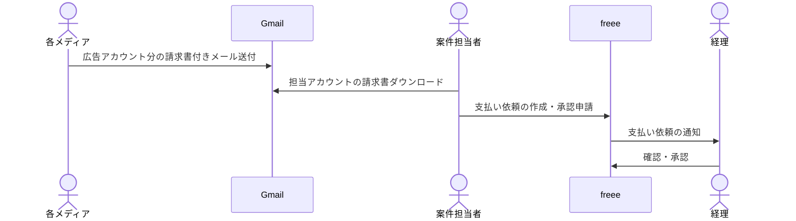
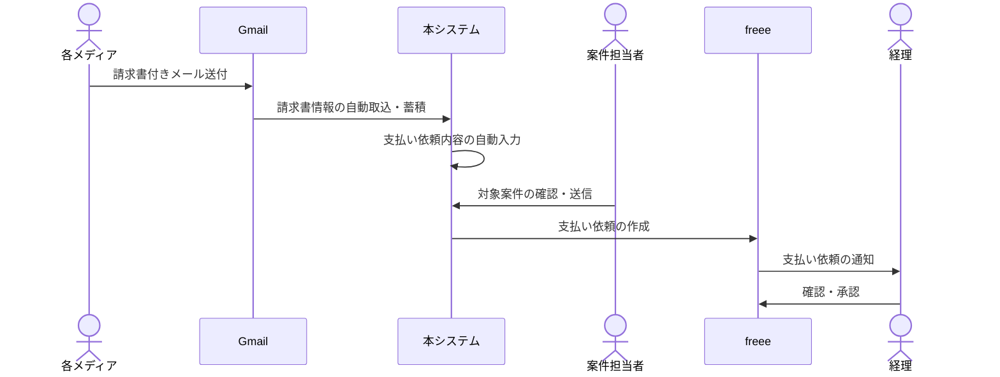

# 業務要件（business_requirements）

## 想定業務

広告配信の代理業を営む会社を想定する。

複数のメディアから月初に送られてくる請求書を、案件ごとに行っている事前申請と紐付け、必要項目を埋めたうえで支払い依頼を行う。

## 業務フロー

### アクター

| アクター | 役割 |
|----------|------|
| 各メディア | 広告アカウント（クライアント）単位の請求書付きメール送付 |
| Gmail | 請求書メールの受領窓口 |
| 案件担当者 | 担当広告アカウントの請求書処理、支払い依頼 |
| freee | 支払い依頼・承認に用いる会計ソフト |
| 経理 | 支払い依頼の確認・承認 |
| 本システム | 請求書の取込・自動入力、事前申請との紐付け確認支援 |

### 業務フロー（As-Is）

現状の負荷: 請求書を見ながらの手入力、事前申請との紐付け作業の案件担当者への集中。

### 業務フロー（To-Be）

## スコープ

### 対象

| ID | 内容 |
|----|------|
| BR-01 | Gmail からの請求書自動取込・蓄積 |
| BR-02 | 支払い前の請求書からの必要項目自動出力 |
| BR-03 | freee 支払い依頼申請用インプットの確定 UI |
| BR-04 | 確定インプットにもとづく freee への支払い依頼作成 |

### 対象外

| ID | 内容 |
|----|------|
| BR-X01 | 支払い依頼後の修正・再依頼・差し戻し対応 |
| BR-X02 | ユーザーごとの情報の出し分け |
| BR-X03 | 経理による freee 上での支払い依頼確認・承認（既存フロー） |

